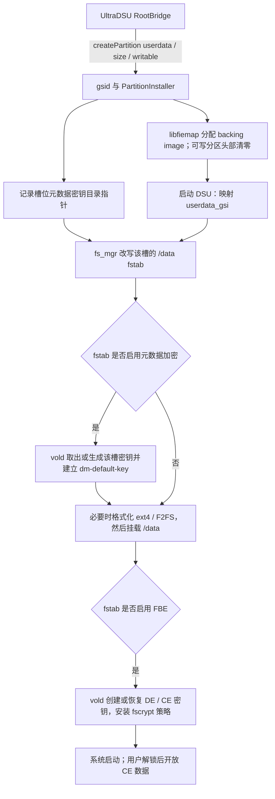

# DSU userdata 的创建与加密链路

核对日期：2026-10-20。主体以 AOSP `android-15.0.0_r1` 为基线，并对照 gsid 主分支。厂商 ROM、旧版 Android 和回移版 gsid 可能不同；应用最低 API 29 不代表所有设备具有相同的加密实现。

## 从安装到首次启动

1. **安装阶段分配空间。** 本应用调用 `createPartition("userdata", size, false)`，`false` 表示可写，不是关闭加密。gsid 写入该槽的密钥目录指针，然后交给 PartitionInstaller / libfiemap 创建镜像。可写分区还会执行名为 `Format()` 的步骤，但此版本实际只映射镜像并写零最前面的 4 KiB，不是创建完整 ext4 / F2FS，也不等于完成客体系统的 FBE 初始化。源码：[gsid](https://android.googlesource.com/platform/system/gsid/+/refs/tags/android-15.0.0_r1/gsi_service.cpp)、[PartitionInstaller](https://android.googlesource.com/platform/system/gsid/+/refs/tags/android-15.0.0_r1/partition_installer.cpp)。

2. **空间文件不是普通加密备份。** libfiemap 通过文件占用的区段构建块映射；AOSP 的 `/data/gsi` 是未施加宿主文件级加密策略的目录，镜像的直接块映射也不能简单等同于通过宿主 `/data` 文件系统读写。不能据“文件放在加密 /data 内”推断客体 userdata 已受完整保护。分配、固定区段、底层文件系统写入也可能耗时，不能把耗时都归为“加密”。源码：[ImageManager](https://android.googlesource.com/platform/system/core/+/refs/tags/android-15.0.0_r1/fs_mgr/libfiemap/image_manager.cpp)、[FiemapWriter](https://android.googlesource.com/platform/system/core/+/refs/tags/android-15.0.0_r1/fs_mgr/libfiemap/fiemap_writer.cpp)。

3. **启动阶段确定加密选项。** `TransformFstabForDsu` 将 `/data` 指向 `userdata_gsi`，设为 logical / formattable，并把元数据密钥目录改成当前槽的目录；其余相关选项来自所处理的 fstab。因此 kernel、fstab、vold、设备密钥服务以及 GSI 的兼容性都可能影响首次挂载，并非只由 gsid 决定。源码：[fstab.cpp](https://android.googlesource.com/platform/system/core/+/refs/tags/android-15.0.0_r1/fs_mgr/libfstab/fstab.cpp)。

4. **元数据加密先于文件系统挂载。** 启用 `keydirectory` 时，vold 的 `fscrypt_mount_metadata_encrypted` 读取或生成密钥，建立 `dm-default-key`；首次初始化需要格式化时，在映射上格式化 ext4 / F2FS，再挂载。`metadata_encryption` 指定算法/选项，不能单独代替 `keydirectory` 开启它。源码：[MetadataCrypt.cpp](https://android.googlesource.com/platform/system/vold/+/refs/tags/android-15.0.0_r1/MetadataCrypt.cpp)、[官方元数据加密说明](https://source.android.com/docs/security/features/encryption/metadata)。

5. **FBE 是另一层。** 挂载 `/data` 后，启用 FBE 的 vold 初始化设备与用户密钥、DE / CE 存储及 fscrypt 策略；CE 的可用性还与用户解锁有关。密钥封装涉及 KeyMint / Keymaster 等设备安全能力，不能通过替换 gsid 就解决所有兼容性，也不能只复制 userdata 镜像就保证跨设备恢复。源码：[FsCrypt.cpp](https://android.googlesource.com/platform/system/vold/+/refs/tags/android-15.0.0_r1/FsCrypt.cpp)、[官方 FBE 说明](https://source.android.com/docs/security/features/encryption/file-based)。

## 密钥在哪里，槽之间如何隔离

- 槽位目录指针：`/metadata/gsi/dsu/<slot>/metadata_encryption_dir`，内容是目录路径，不是明文密钥。
- 默认槽位元数据密钥目录：`/metadata/vold/metadata_encryption/dsu/<slot>/`，vold 在其下管理 `key`、临时目录等。
- FBE 用户密钥：客体系统自己 `/data/misc/vold/user_keys/` 下的 DE / CE 密钥记录；其所在 `/data` 是该槽的 userdata，和宿主的 `/data` 不同。

前两个路径来自 [libgsi.h](https://android.googlesource.com/platform/system/gsid/+/refs/tags/android-15.0.0_r1/include/libgsi/libgsi.h)。目录路径与封装的密钥文件不能混为一谈；调试功能不读取这些文件、不导出 dm 表或密钥材料。

## 与本项目维护功能的关系

保留数据扩容的实现、文件系统差异与验证记录，另见 [保留数据扩容](DSU_USERDATA_GROWTH.md)。Alpha 6 已加入带完整备份与回退的实验性入口，具体兼容范围和实测结果见该文档；原有重建入口仍会清除数据。

- **错误码 1** 是 gsid 的通用安装失败，不能仅凭它判断加密失败。先看失败阶段及 gsid / libfiemap 日志：目录与 SELinux、空间阈值、区段分配、映射和元数据写入都可能失败。若安装成功而首次开机失败，再重点看 fs_mgr / vold 的 `read_key`、映射、格式化、KeyMint 与 fscrypt 报错。
- **重建 userdata 扩容会清空数据。** 当前实现让 gsid 删除旧 backing image 并创建更大的镜像，没有解锁旧文件系统、复制数据或原地扩容。它通常不主动销毁外置的槽位元数据密钥；复用元数据密钥不代表保留了旧文件系统或原 DE / CE 密钥。不要把直接扩大 backing file 当作完成 dm / 文件系统 / 加密映射扩容。
- **多槽删除存在维护缺口。** AOSP 的完整移除还调用 `vold.destroyDsuMetadataKey(slot)` 并清理目录指针；本项目为保留其他槽而走的自定义多槽删除路径，目前仅删除 backing images 和注册标记，没有同等清理。可能残留该槽的元数据密钥与指针。这是 Alpha 5 的代码核对结论，尚未通过删除真实槽验证；Alpha 6 的正式扩容流程也不调用槽位密钥销毁。后续需实现受校验的逐槽密钥清理，并测试失败恢复及其他槽不受影响。[AOSP 删除实现](https://android.googlesource.com/platform/system/gsid/+/refs/tags/android-15.0.0_r1/gsi_service.cpp)、[vold 清理实现](https://android.googlesource.com/platform/system/vold/+/refs/tags/android-15.0.0_r1/MetadataCrypt.cpp)。

## 本次只读设备核对

Alpha 5 的只读分析中，Aura A1 主系统报告 `ro.crypto.state=encrypted`、`ro.crypto.type=file`、`ro.crypto.metadata.enabled=true`。这些只证明当时主系统报告的状态，不能据此推断具体算法或某个槽的密钥可成功解封。该阶段没有启动、格式化或重建真实槽，也没有读取密钥材料。后续 Alpha 6 在用户授权的测试槽中实现并验证了保留数据扩容；原生维护进程仅在内存中解封装和使用已有密钥，详见 [扩容实现与验证](DSU_USERDATA_GROWTH.md)。

## 调试与导出

在设置打开调试模式后复现操作，再导出 TXT。开关跨进程保留；关闭即停止新记录，旧日志仍可导出/清空。应用私有目录按两个 512 KiB 文件轮转，记录操作起止、Root 桥接耗时、阶段与字节进度、异常类型和有限堆栈。

Root 已授权且调试开启时，可手动采集固定白名单中的加密状态属性及 gsid / vold / fs_mgr 的近期 logcat。不会自动申请 Root、抓取整机 bugreport、遍历属性或读取密钥。缓冲区可能包含调试开关开启前的系统事件；主系统也可能没有客体系统首次启动的报错，必要时仍需从实际失败的客体系统或 recovery 取得对应日志。

日志在写入和导出时脱敏路径、URI、已知槽名/镜像名、常见标识字段等。规则脱敏不能保证识别厂商日志中每一种私人文本，分享前仍应检查；导出由系统文档选择器保存到用户选择的位置，不会自动上传。
