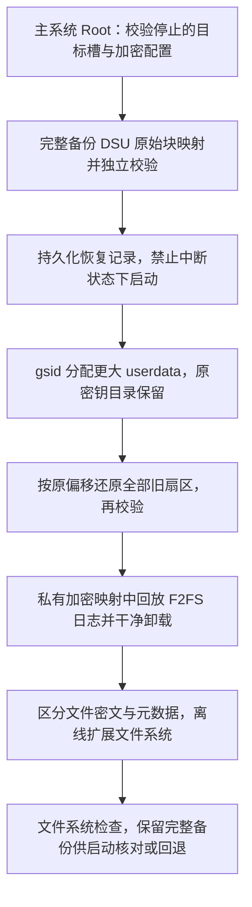

# 保留数据扩容 DSU userdata

日期：2026-10-20。Alpha 6 增加独立的实验性“保留数据扩容”入口；原有“清空并重建 userdata”仍会清除数据。两者在槽编辑页分别展示。

Alpha 7 修复兼容性检查失败后卡片无结果的问题：包括 Root 桥接失败、旧槽布局和系统版本不符合要求，结果都在按钮下方显示；检查期间按钮显示“正在检查…”。“检查兼容性与备份”读取已有备份状态，不会新建完整备份；真正的备份由用户确认“保留数据扩容”后开始。刷新失败会保留标明“上次确认”的备份信息，并禁用过期结果对应的操作，重新检查成功后恢复。

Alpha 9 增加可选的 [客体协作流程](DSU_GUEST_ASSISTANCE.md)：由主系统硬件 Keystore 保护临时交接，正常运行的客体加密采集所需维护信息，再返回主系统完成原有全量备份和离线扩容。V50 Pro 已完成 16→18 GiB 实际扩容、两次冷启动解锁及加密文件 / 新增容量校验；详细结果和未覆盖范围见 [设备验收](DEVICE_TESTING.md)。

加密 F2FS 的离线搬移目前使用对齐的逐块直接 I/O，搬移数据块时还会更新节点；累计写入量可能明显大于槽内已用容量。这是为了避免原始密文视图与元数据解密视图的脏缓存互相覆盖，但在部分设备上会很慢。该阶段显示不定进度，不将累计写入量伪装成整体百分比；应等待文件系统及加密记录复核结束后再启动客体。

已为 F2FS 原生局部整理扩容路径实现实验性密文感知搬移，尽量让未受新增元数据区域影响的数据保持原位。`build.py --local-growth` 的 V50 独立副本通过文件系统及密封记录检查，文件系统阶段约 43 秒；该候选随后通过真实客体冷启动、CE / DE 与硬链接校验及新增容量读写，并已恢复测试前状态。Alpha 9 正式资产仍使用原路径。测量口径与覆盖范围见 [局部搬移验收](LOCAL_GROWTH_VALIDATION.md)，不能将单次副本计时视为所有设备的整体事务性能。

Alpha 11 的随包原生工具改为启用 `--local-growth`，不再沿用 Alpha 9/10 的默认全 Main 区搬移资产。局部整理不能完成时仍有上游全量迁移回退；应用分别显示局部整理和全量扫描阶段。整理/扫描进度按当前逻辑区域计量，不代表整个任务百分比或实际闪存写入字节数。节点表、段信息、摘要和检查点阶段分别显示阶段名称及不定进度。大容量文件系统维护的单阶段上限调整为六小时，仍保留备份和中断恢复保护。

razr 2022 的 Android 14 原生依赖与硬件封装密钥适配缺口见 [专项诊断](RAZR_USERDATA_GROWTH.md)；当前的 API 限制不能直接删除后视为支持。

## 实现路径

`IImageService` 没有保留数据的 resize 接口，而 gsid 的 `createPartition` 会先删除原镜像。因此先生成完整且校验通过的独立备份，再分配与恢复；不能只扩大 backing file，或把原重建按钮改个名称。[IImageService](https://android.googlesource.com/platform/system/gsid/+/refs/tags/android-15.0.0_r1/aidl/android/gsi/IImageService.aidl)、[PartitionInstaller](https://android.googlesource.com/platform/system/gsid/+/refs/tags/android-15.0.0_r1/partition_installer.cpp)。

备份读取经过 gsid 验证的 `userdata_gsi` 原始块映射。普通 `cp userdata_gsi.img.0000` 可能经过宿主元数据加密，不能当作相同视图。还原保留逻辑扇区偏移、槽位元数据密钥、userdata 内的 FBE / Keystore 状态，不调用密钥销毁或重新生成。[FiemapWriter](https://android.googlesource.com/platform/system/core/+/refs/tags/android-15.0.0_r1/fs_mgr/libfiemap/fiemap_writer.cpp)、[ImageManager](https://android.googlesource.com/platform/system/core/+/refs/tags/android-15.0.0_r1/fs_mgr/libfiemap/image_manager.cpp)。

原生维护进程通过 AOSP KeyStorage / Keystore 只读解封装已有密钥，创建目标槽专用的 `dm-default-key` 视图。密钥仅在进程和内核内使用，不通过参数、日志或导出文件传递；禁用 core dump 和可能包含 dm 表的库日志。工具不替换宿主 vold，也不修改宿主 `/data` 映射。

F2FS 完整扩容可能搬移 Main 区。元数据解密视图不等于所有文件均已解密：fscrypt 常规文件的数据需要经原始块视图搬移，节点、目录和其他元数据经默认密钥视图搬移；保留 inode 与文件逻辑块偏移。单纯让普通 `resize.f2fs` 搬移全部数据，或者只确认 fsck 通过，均不足以证明加密文件正常。[dm-default-key](https://android.googlesource.com/kernel/common/+/refs/heads/android14-6.1/drivers/md/dm-default-key.c)、[F2FS resize](https://android.googlesource.com/platform/external/f2fs-tools/+/refs/tags/android-15.0.0_r1/fsck/resize.c)。

非干净检查点只在已备份、已迁移的候选镜像上由内核正常回放。维护进程创建私有 mount namespace，挂载后正常卸载，再执行离线扩容；不会强行更改检查点标志，也不加载 CE / DE 用户密钥来遍历用户文件。挂载、卸载或后续检查失败均保留备份。

块设备映射之间存在独立缓存：内核挂载回放及离线工具写入后，会同步并失效两个块视图的缓存；密文搬移与元数据写入均使用对齐的直接 I/O，避免旧元数据脏页随后覆盖已迁移的密文。维护工具还在只读私有挂载中使用既有系统 DE 密钥，核对封装的用户密钥记录：回放前、回放后和扩容后内容须一致，版本记录须有效。不会解封装 CE 用户密钥或遍历用户个人文件，密钥记录摘要仅在维护进程内比较。

## 恢复与限制

- 应用最低 API 29 保持不变；这套原生工具当前要求 Android 16+、arm64、主系统 Root 和标准内部多槽布局，并逐设备预检。
- 满足 Android 16+ 不保证主系统能使用已有槽位密钥。客体系统或安全补丁高于主系统时，密钥的 KeyMint 版本绑定可能使主系统返回 `KEY_REQUIRES_UPGRADE`，随后以 `INVALID_ARGUMENT` 拒绝降级。槽在客体中正常启动，不代表主系统离线维护能读取同一密钥；不能通过更换或重建原密钥解决保留数据扩容。Alpha 8 在此类错误中提示版本绑定的可能性，并保留原先的拒绝行为。[KeyMint upgradeKey 规则](https://android.googlesource.com/platform/hardware/interfaces/+/refs/tags/android-16.0.0_r1/security/keymint/aidl/android/hardware/security/keymint/IKeyMintDevice.aidl)。
- 当前支持预检通过的 F2FS；元数据加密只接受已适配的 AES-XTS、现代参数格式和普通密钥。硬件封装密钥、未知算法、非标准目录均拒绝。
- 元数据加密的 ext4 离线扩容暂未开放，需要独立验证在线或加密感知路径。未加密 ext4 的实现使用系统 `e2fsck` / `resize2fs`，尚无本次真机覆盖。
- 扩容前预估完整旧备份、新分配镜像、Virtual A/B 的 super 预留和余量，不能只计算新增的容量差。空间不足会在替换前拒绝。
- `/data/adb/ultradsu/growth/<slot>/` 保存完整原始备份和 fsync 后原子更新的阶段记录。记录中只有尺寸、状态、摘要及密封密钥记录的标识摘要，不保存解封装密钥。
- 替换后的中断状态阻止该槽启动、分区重写及备份删除。重新打开兼容性页面会恢复本应用留下的安装会话和私有映射；不会接管其他工具的安装会话。失败后从备份回退会恢复扩容前状态，扩容后新增的数据会丢失。
- 备份或密钥标识不符时拒绝回退，避免把旧备份写入重建后的同名槽。保留备份期间禁止删除槽或清空重建 userdata。
- 应用进程锁只约束 UltraDSU；维护时避免同时使用其他 Root DSU 工具。备份留在同一设备，不等于独立的离机灾备。
- 完成后保留原大小的完整备份；启动目标系统核对数据后，由用户单独清理。界面进度为当前备份/校验/恢复阶段，文件系统扩容使用不定进度。

## 验证记录

事务单元测试覆盖备份失败不修改原数据、分配中断、文件系统工具拒绝、跨实例回退、备份篡改、密钥标识改变及重复扩容限制。模拟测试不代表实际断电或任意厂商组合已验证。

Aura A1 的真实测试限定在用户授权的 `aura_v92`：F2FS、FBE 和元数据加密，原镜像 8 GiB。第一次迁移的完整原始数据校验通过；文件系统工具因非干净检查点拒绝扩容，随后实际回退到 8 GiB，并再次逐字节校验。修正后的扩容及启动验证记录见 [设备验收](DEVICE_TESTING.md)。

源码、完整 F2FS 上游源码、密文搬移补丁与构建说明见 [native/userdata-grow](../native/userdata-grow/README.md)。相关背景：[DSU userdata 加密链路](DSU_USERDATA_ENCRYPTION.md)。
